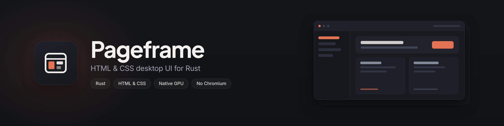

# Pageframe

<p align="center"></p>

<p align="center">
  <a href="https://github.com/RealWhyKnot/Pageframe/actions/workflows/ci.yml"></a>
  
  <a href="#license"></a>
</p>

<p align="center">
  <a href="#quick-start">Quick start</a> ·
  <a href="https://github.com/RealWhyKnot/Pageframe/issues/new">Report a bug</a> ·
  <a href="https://github.com/RealWhyKnot/Pageframe/releases">Releases</a> ·
  <a href=".github/SECURITY.md">Security</a>
</p>

Pageframe renders HTML and CSS natively in Rust desktop apps. You can handle events and update the page from Rust or load a page that runs its own JavaScript. Stylo computes styles, Taffy and Parley handle layout, and Vello draws the page.

Pageframe forked [Blitz](https://github.com/DioxusLabs/blitz) at [commit b6bb45c](https://github.com/DioxusLabs/blitz/commit/b6bb45c550a9490afa6c43468c77535c6d76856d). Earlier history is in the Blitz repository.

## Quick start

```rust
use pageframe::{App, Error, EventKind};

const PAGE: &str = r#"
<button id="add">Add one</button>
<span id="count">0</span>
"#;

fn main() -> Result<(), Error> {
    App::new(0_u32, PAGE)
        .stylesheet("button { padding: 0.5rem 1rem; }")
        .on("#add", EventKind::Click, |count, ui, _| {
            *count += 1;
            ui.select("#count").set_text(&count.to_string());
        })
        .run()
}
```

Run the counter with `cargo run -p pageframe --example counter`. For a larger example, run `cargo run -p pageframe --example todo` or read the [to-do list source](crates/pageframe/examples/todo).

## What it does

- HTML and CSS, including selectors, the cascade, layout and text.
- JavaScript and the DOM through the [Boa](https://github.com/boa-dev/boa) engine, including ES modules.
- `fetch()` and `EventSource` over HTTP. To load HTTPS pages, supply your own `NetProvider`.
- Cookies and an `ipc` object that lets page scripts call into your Rust code.
- Canvas 2D and `OffscreenCanvas`, modal `<dialog>`, form controls, and clipboard access through the host.
- Audio, video and Web Audio through Windows Media Foundation. On other platforms, media elements load but don't play.
- An opt-in Chrome DevTools server for inspecting a running page.

Pages loaded over the network can't read local `file:` URLs. Pages loaded from disk, and pages built into an `App`, can.

## Two ways to use it

`App` is for apps written in Rust. Your Rust handlers react to events and edit the DOM, and the page runs no scripts.

- `App::new(state, html)` takes your starting state and the page. `App::from_file(state, path)` reads the page from disk and resolves relative links from its folder.
- `.stylesheet(css)` adds CSS after the page's own styles.
- `.asset(path, bytes)` serves a file the page links to, such as `app.css` or an image, from memory. Pair it with `include_bytes!` to build everything into the binary.
- `.on(selector, kind, handler)` calls `handler(&mut state, &mut ui, &mut event)` when an event of that kind reaches an element matching `selector`. Events bubble, so clicking a `<span>` inside `#add` still runs the `#add` handler.
- `.on_start(f)` runs once after the page loads. `.title(..)` and `.size(..)` set up the window, and `.run()` opens it.

In a handler, `ui.select(selector)` returns the matching elements. Read them with `text`, `value`, `attr`, `checked` and `has_class`, or change them with `set_text`, `set_html`, `set_attr`, `set_value`, `add_class`, `set_style`, `append` and `remove`. `ui.instantiate("#row-template")` clones a `<template>`'s contents, and `find`, `closest`, `parent` and `children` walk the tree. `ui.select("#chart").draw(|canvas| ..)` draws on a `<canvas>` from Rust.

`pageframe::host` is for pages that run their own JavaScript. `HostSession` loads a URL or an HTML string, runs its scripts, and takes input events from your window loop. `PageframeHost` wraps a session around a window and draws it.

- `on_ipc` answers `ipc.invoke(channel, payload)` calls from the page, and `emit` sends events that the page hears with `ipc.on(channel, listener)`.
- `on_navigation` decides which links the page may follow. Without it, a session only follows links on the same origin.
- `take_events` reports title, cursor, clipboard and navigation changes for your window to act on.

Scripts on the loaded page can call your IPC handlers. If the session can navigate to a remote site, check `session.url()` before acting on an IPC request.

## Features

`gpu`, `svg` and `accessibility` are on by default.

| Feature         | What it does                                                                                      |
| --------------- | ------------------------------------------------------------------------------------------------- |
| `gpu`           | Draws windows with Vello on the GPU.                                                              |
| `svg`           | Renders inline `<svg>` and SVG images.                                                            |
| `accessibility` | Exposes the page to screen readers through AccessKit.                                             |
| `software`      | Draws windows on the CPU. It's used when `gpu` is off, so set `default-features = false` with it. |

Use either `gpu` or `software` to open a window with `.run()`. `app.page(..)` also works with both features off.

DevTools is a feature of `pageframe-shell`. Turn on `devtools` to start a Chrome DevTools Protocol server on localhost, and `embedded-devtools-frontend` to serve the DevTools page from that server, so any Chromium browser can open it.

## Testing your app

`app.page(width, height)` builds the page without opening a window. Wrap it in `pageframe-test-harness` to click, type and check layout:

```rust
let mut harness = Harness::wrap(app.page(400, 300).expect("selectors are valid"));
harness.click("#add");
assert_eq!(harness.text_content("#count"), "1");
```

## Crates

| Crate                    | What it holds                                |
| ------------------------ | -------------------------------------------- |
| `pageframe`              | The `App` and `host` APIs that apps use.     |
| `pageframe-dom`          | The DOM, styling and layout.                 |
| `pageframe-html`         | The HTML parser.                             |
| `pageframe-paint`        | Paints a document through anyrender.         |
| `pageframe-script`       | JavaScript, `fetch`, IPC and media, on Boa.  |
| `pageframe-shell`        | The winit window shell.                      |
| `pageframe-devtools`     | The Chrome DevTools Protocol server.         |
| `pageframe-traits`       | Types shared between the crates.             |
| `pageframe-test-harness` | Headless clicking, typing and layout checks. |
| `stylo_taffy`            | Converts Stylo styles to Taffy styles.       |

## Adding it to your project

Pageframe is available through Git. Add the dependency and both patch tables to your workspace root `Cargo.toml`. Replace `PAGEFRAME_COMMIT` with the same commit SHA in all five entries.

```toml
[dependencies]
pageframe = { git = "https://github.com/RealWhyKnot/Pageframe.git", rev = "PAGEFRAME_COMMIT" }

[patch.crates-io]
glifo = { git = "https://github.com/DioxusLabs/vello", rev = "be500db2b3a9cb3613de0e2c43f9358635c1f309" }
vello_common = { git = "https://github.com/DioxusLabs/vello", rev = "be500db2b3a9cb3613de0e2c43f9358635c1f309" }
vello_cpu = { git = "https://github.com/DioxusLabs/vello", rev = "be500db2b3a9cb3613de0e2c43f9358635c1f309" }
parley = { git = "https://github.com/RealWhyKnot/Pageframe.git", rev = "PAGEFRAME_COMMIT" }
parley_engine = { git = "https://github.com/RealWhyKnot/Pageframe.git", rev = "PAGEFRAME_COMMIT" }

[patch."https://github.com/DioxusLabs/anyrender"]
anyrender_vello = { git = "https://github.com/RealWhyKnot/Pageframe.git", rev = "PAGEFRAME_COMMIT" }
anyrender_vello_cpu = { git = "https://github.com/RealWhyKnot/Pageframe.git", rev = "PAGEFRAME_COMMIT" }
```

Cargo uses the patch tables from your workspace root. For a local checkout, use a path to `crates/pageframe` and copy both tables from [Pageframe's Cargo.toml](Cargo.toml). Set each patch path to its directory in that checkout.

You need Rust 1.99 or newer and Python 3, which Stylo's build script uses. On Linux you also need `pkg-config` and `libfontconfig-dev`. [CONTRIBUTING.md](CONTRIBUTING.md) has the full list.

## Versioning

Pageframe follows [Semantic Versioning](https://semver.org) (`MAJOR.MINOR.PATCH`), starting at `0.1.0`.

Before `1.0.0`, Pageframe uses a minor bump (`0.1.0` to `0.2.0`) for breaking changes to the API or its behavior. Patch bumps (`0.1.0` to `0.1.1`) keep existing apps compatible.

From `1.0.0` on, a major bump breaks things, a minor bump adds features that keep working with your code, and a patch bump fixes bugs.

Nightly prereleases are tagged like `v0.2.0-beta.20261124.0`: the version the next release will get, the date in `YYYYMMDD` form, and a counter for that day. The part before `-beta` shows whether the next release breaks anything. If a commit since the last release is marked as breaking, with a `!` after its type (`feat!:`) or a `BREAKING CHANGE:` footer, it jumps to the next breaking version.

## Links

- [CONTRIBUTING.md](CONTRIBUTING.md) explains how to build, test and report bugs.
- [.github/SECURITY.md](.github/SECURITY.md) explains how to report a security problem.
- [CHANGELOG.md](CHANGELOG.md) lists changes by release.
- [docs/licensing.md](docs/licensing.md) covers dependency licenses.

## License

Pageframe is [MIT](LICENSE-MIT) OR [Apache-2.0](LICENSE-APACHE). The vendored Stylo CSS crates are MPL-2.0.
See the [licensing guide](docs/licensing.md) for what to ship with your app and [NOTICE](NOTICE) for third-party credits.
